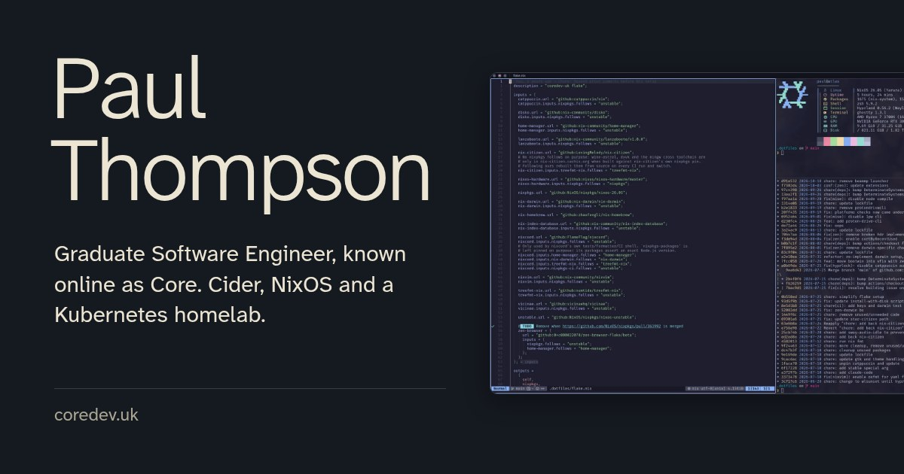

### coredev.uk

[](https://coredev.uk)
[](https://astro.build)
[](https://workers.cloudflare.com)

The personal site of Paul Thompson, known online as Core: projects, write-ups and writing.

[Website](https://coredev.uk) •
[Development](#development) •
[Content](#content) •
[Issues](https://github.com/coredev-uk/coredev.uk/issues)

<br clear="left">



## Development

<details>
<summary>Run the site locally and deploy it</summary>

Bun and Node come from the Nix dev shell in `flake.nix`. With direnv and nix-direnv, entering the folder loads it; otherwise run `nix develop` first.

```sh
bun install
bun run dev      # local dev server
bun run build    # static build into dist/
bun run preview  # build, then serve it with Wrangler as Cloudflare would
bun run deploy   # build and deploy with Wrangler
```

</details>

## Content

<details>
<summary>Where the pages and pictures live</summary>

- Project write-ups live in `src/content/projects/`, blog posts in `src/content/blog/`.
- The projects list on the home and projects pages comes from `src/data/work.ts`.
- Screenshots used on the site are in `public/work/`.

</details>

## Contributing

Report problems with the site in [Issues](https://github.com/coredev-uk/coredev.uk/issues).
For anything else, email [core@coredev.uk](mailto:core@coredev.uk).

## Licence

The content of this site is licensed under the Creative Commons Attribution-ShareAlike 4.0
International licence ([LICENSE](LICENSE)).
